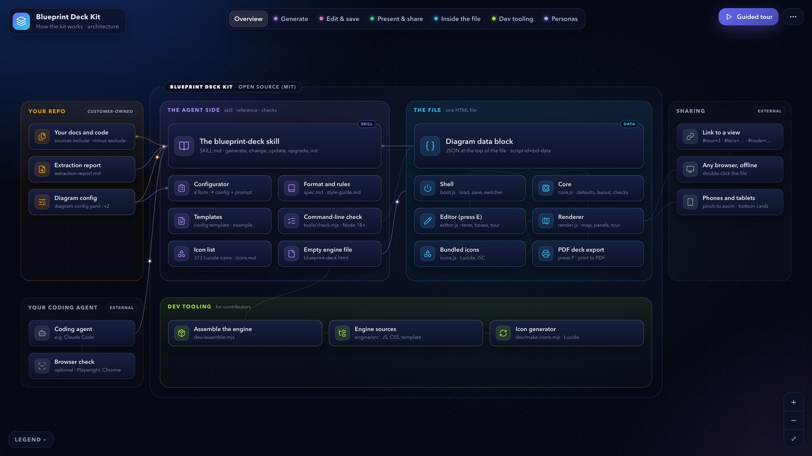
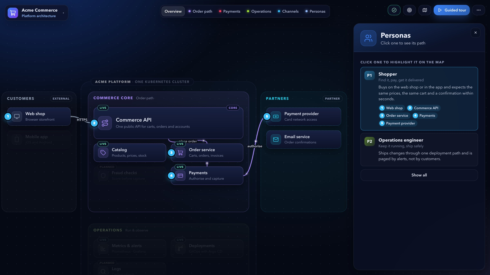
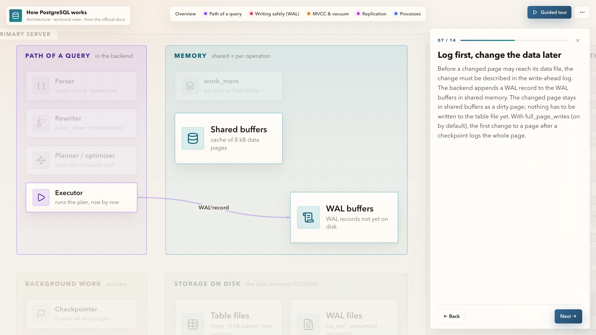
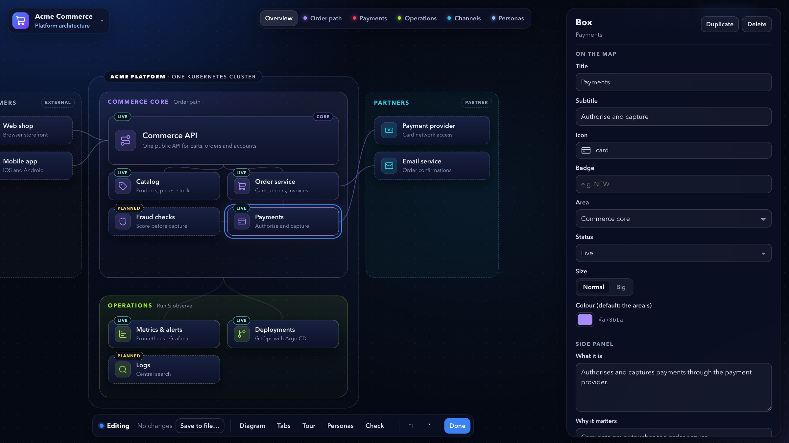
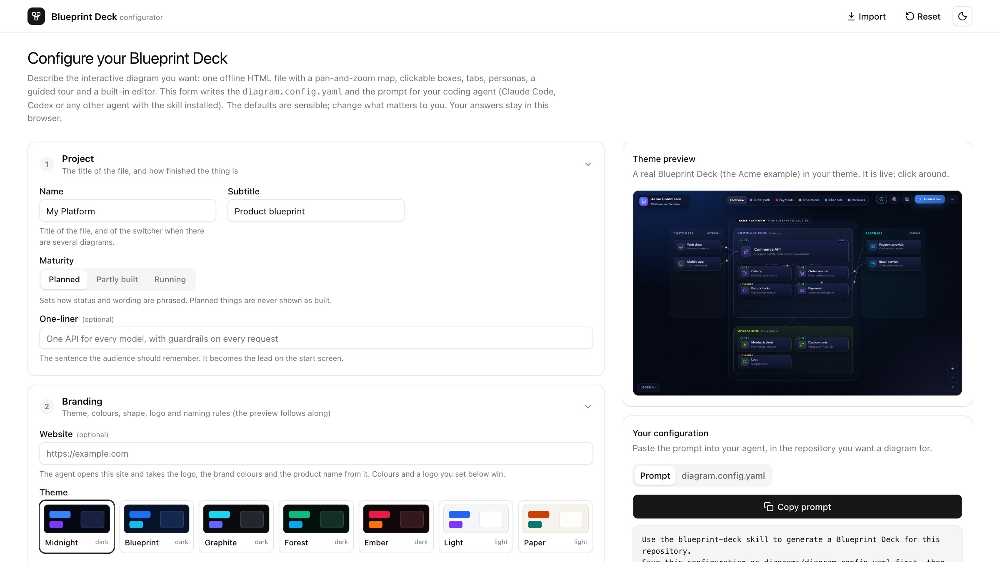

# Blueprint Deck Kit

**Turn your docs into a deck people will love: an interactive diagram you can present, edit and send as one file.**

**Free and open source (MIT).** No account, no tracking, nothing else to install: it runs on your own coding agent.


▶ **[Watch the 1-minute video](https://blueprintdeck.dev/#video)** · **[Try a live deck](https://blueprintdeck.dev/examples/acme/index.html)**

Your coding agent (Claude Code, Codex or any agent that supports skills) reads your docs or your code and writes a
*Blueprint Deck*: a pan-and-zoom map of your product, process or system that is also a slide deck.

- **Click any box** for a side panel: what it is, why it matters, the technology, its sources.
- **Tabs** highlight one question at a time: the request path, governance, cost, the manual steps.
- **Personas**: pick one and see its numbered path through the map.
- **A guided tour** tells the story step by step; the camera follows. Use ← → like slides.
- **Sheets** for what isn't a place on the map: roadmap, pilot options, pricing tiers.
- **Several diagrams in one file**, e.g. a product view for executives and a technical view for engineers.
- **Edit it in the browser**: press **E** to change texts, colours, theme, logo, boxes, tabs, tour and personas.
- **One HTML file** that works offline, on phones, in any browser. **P** exports a PDF deck, in colour or black and white.

It works for product and architecture blueprints, data flows, business processes, customer journeys, partner
ecosystems and org maps, in a product (what it does for whom) or technical (components and technology) viewpoint.

| | |
|---|---|
|  |  |
| **The map**: areas, boxes, connections, tabs | **Personas** with their numbered path through the map |
|  |  |
| **A guided tour**, here on the light `paper` theme | **The editor** (press E): no agent, no rebuild |
|  | |
| **The configurator** writes the config and the prompt | |

**[Website & configurator](https://blueprintdeck.dev)** ·
**[Examples](https://blueprintdeck.dev/gallery/)** ·
**[Docs](https://blueprintdeck.dev/docs/)**

---

## Quick start

### 1. Install the skill (once)

Pick the place you work in:

**Claude Code**: as a plugin, from your terminal:
```
claude plugin install blueprint-deck --marketplace lukasvecerka23/blueprint-deck-kit
```
Or inside Claude Code: `/plugin install blueprint-deck --marketplace lukasvecerka23/blueprint-deck-kit`. Then type `/blueprint-deck`. On Claude Code older than 2.1.275, run
`/plugin marketplace add lukasvecerka23/blueprint-deck-kit` and then `/plugin install blueprint-deck@blueprint-deck-kit`.
Updates: turn on auto-update under `/plugin` → Marketplaces, or run `claude plugin update blueprint-deck@blueprint-deck-kit`.

**Codex** (and the ChatGPT desktop app): as a plugin, in your terminal:
```
codex plugin marketplace add lukasvecerka23/blueprint-deck-kit && codex plugin add blueprint-deck@blueprint-deck-kit
```
Updates: `codex plugin marketplace upgrade`. The plugin also appears in the ChatGPT desktop app. Or, inside Codex,
its own skill installer (installs from `main` and doesn't update later):
```
$skill-installer install https://github.com/lukasvecerka23/blueprint-deck-kit/tree/main/plugins/blueprint-deck/skills/blueprint-deck
```

**Gemini CLI**: with its own skill installer:
```
gemini skills install https://github.com/lukasvecerka23/blueprint-deck-kit --path plugins/blueprint-deck/skills/blueprint-deck
```

**Chat apps** (no terminal):
- **Claude** (web and desktop app, paid plans): **Customize → Skills**, upload
  [blueprint-deck-skill.zip](https://github.com/lukasvecerka23/blueprint-deck-kit/releases/latest/download/blueprint-deck-skill.zip) unchanged, turn it on (code execution must be on).
- **ChatGPT on the web** (paid plans): **Plugins → Skills → Create → Upload**, the same zip.
- **ChatGPT desktop app**: install the Codex plugin above (the app shares Codex's plugins), or in the app **Plugins** →
  add the marketplace `lukasvecerka23/blueprint-deck-kit`.
- **Gemini** (web and desktop app): **Customize → Skills**, upload
  [blueprint-deck-skill-gemini.zip](https://github.com/lukasvecerka23/blueprint-deck-kit/releases/latest/download/blueprint-deck-skill-gemini.zip) (without the optional Node tools, which Gemini doesn't accept).

Then attach your docs to a chat and ask for a Blueprint Deck.

**Install script**: for any other agent, several at once, Windows or a specific version. It installs the latest
[release](https://github.com/lukasvecerka23/blueprint-deck-kit/releases) for the agents it finds (`~/.claude/skills`,
`~/.codex/skills`, `~/.gemini/skills`, `~/.agents/skills`) and asks which when there are several.

macOS / Linux:
```bash
curl -fsSL https://raw.githubusercontent.com/lukasvecerka23/blueprint-deck-kit/main/install.sh | sh
```
Windows (PowerShell):
```powershell
irm https://raw.githubusercontent.com/lukasvecerka23/blueprint-deck-kit/main/install.ps1 | iex
```
Options: `--agent claude|codex|gemini|agents|all`, `--dir <folder>` (any other agent's skills folder), `--project` (into the
current project), `--version 2.1.0` (a specific release), `--yes` (don't ask), `--uninstall`; pass them with
`sh -s --`. With PowerShell, `-Agent`, `-Version` … by running the script like this:
```powershell
$installer = irm "https://raw.githubusercontent.com/lukasvecerka23/blueprint-deck-kit/main/install.ps1"
& ([scriptblock]::Create($installer)) -Version 2.1.0
```
Run it again to update.

- **From a clone** (e.g. to try unreleased changes on `main`): `./install.sh` installs that checkout.
- **By hand:** download `blueprint-deck-skill.zip` from a [release](https://github.com/lukasvecerka23/blueprint-deck-kit/releases)
  and unzip it into your agent's skills folder.

Nothing else to install, no account: the skill is plain files, and the agent runs on your computer with your own subscription.

### 2. Describe the diagram

Open the **[configurator](https://blueprintdeck.dev/configurator/)** (or `configurator/index.html`
from a clone, offline). Pick the type, viewpoint, audience, sources, tabs, tour, look and brand colours, one tab per
diagram if you want several. Click **Copy prompt**: it contains the whole configuration.

No form? Just ask your agent: *"Use the blueprint-deck skill to make a diagram of these docs."* It asks the few
things it needs.

### 3. Generate

Paste the prompt into your agent, in your project folder: a code repository, or any folder of docs (Markdown, text or PDF files). The agent:
1. reads the sources from the config,
2. proposes the structure (areas, personas, tabs, tour) and waits for your OK,
3. writes `diagrams/index.html` and an `extraction-report.md` (sources read, conflicts between your docs, gaps,
   assumptions),
4. checks every tab and tour step, and fixes what doesn't fit.

### 4. Present, change, share

- Open `diagrams/index.html`. `←` `→` / Space walk the tour, `Esc` closes, `F` fits the map, `1`–`9` switch
  diagrams, `P` makes a PDF deck.
- **Small changes: press E.** Click a box or an area to edit it, drag boxes to move them, change the theme and colours,
  upload a logo, edit tabs, tour steps and personas. In Chrome and Edge your changes are saved straight into the file;
  in other browsers they are kept in the browser until you download the updated file.
- **Bigger changes: ask the agent.** "Make it more technical", "add a persona for the auditor", "step 7 should also
  show the registry", "shorten the tour to 10 steps". When your docs change: "update the diagram".
- **Send a read-only copy:** ⋯ → **Download a copy to share** → Read-only gives you a file without the editor,
  under a name you choose; your own file stays editable.
- **Share** the file by email or chat, or upload it to any static host (Cloudflare Pages, Netlify, GitHub Pages, your
  intranet) for a link that also works on phones. Deep links open a view directly: `index.html#tour=5`,
  `#lens=governance`, `#node=gateway`, `#list=personas&item=2`.

---

## Updating

- **The skill** mentions it when a newer version is out ([what's new](https://github.com/lukasvecerka23/blueprint-deck-kit/releases)).
  To update: Claude Code plugin: `claude plugin update blueprint-deck@blueprint-deck-kit` (or auto-update);
  Codex/ChatGPT desktop plugin: `codex plugin marketplace upgrade`; Claude, ChatGPT (web) or Gemini: delete the skill
  and upload the newer zip; install script (also for Codex): run it again, it says
  which version it replaced. A specific release: add `--version 2.1.0` (PowerShell: `-Version 2.1.0`).
- **Your diagrams** keep working as they are: each file carries its own engine. To give a file the new features,
  ask your agent to "upgrade diagrams/index.html to the newest engine"; your content stays as it is. The editor
  (E → Diagram) shows which engine a file has.

## How it works

```
diagram.config.yaml ──▶ your agent + the blueprint-deck skill ──▶ diagrams/index.html
   what you want           reads docs or code, writes the content    the engine + your diagram's JSON
   (configurator)          as JSON, checks the result                 one file, opens anywhere
```

The engine is fixed and lives inside every file; the agent only writes the diagram's content (areas, boxes,
connections, tabs, personas, tour, sheets) as a JSON block at the top of the file. That is why every diagram behaves
the same, why it needs no build step, and why you can edit it without the agent. The format is documented in
[`plugins/blueprint-deck/skills/blueprint-deck/reference/spec.md`](plugins/blueprint-deck/skills/blueprint-deck/reference/spec.md); the rules the agent follows in
[`SKILL.md`](plugins/blueprint-deck/skills/blueprint-deck/SKILL.md) and the [style guide](plugins/blueprint-deck/skills/blueprint-deck/reference/style-guide.md).

Optional, if you have Node 18+: `node ~/.claude/skills/blueprint-deck/tools/check.mjs diagrams/index.html --explain`
validates a file and lists what each view highlights. Without Node, press E → Check in the browser.

## Examples

Open them from [`examples/`](examples/) or the [gallery](https://blueprintdeck.dev/gallery/):
- `acme`: a fictional shop, two diagrams in one file (platform architecture with personas + checkout process)
- `blueprint-deck`: this kit explaining itself
- `saas-onboarding`: a customer journey (fictional), light theme
- `postgresql`: how PostgreSQL works, a technical view built from the official docs
- `online-boutique`: Google's microservices demo, built from its code alone (unofficial)
- `meetbuddy`: a macOS meeting recorder from its code, a product and a technical diagram in one file (unofficial)

## Security

Every deck blocks all network requests (a Content Security Policy in the file), and the engine strips scripts and
event handlers from the content before showing it, so a deck built from documents you don't control can't run code in
your viewers' browsers. Mail filters may still block `.html` attachments in general: share a link or a PDF instead.
Details in [SECURITY.md](SECURITY.md).

## Requirements

- A coding agent that supports Agent Skills (`SKILL.md`), such as Claude Code or Codex.
  Other agents can be pointed at `SKILL.md` as instructions.
- A modern browser (Chrome, Edge, Safari, Firefox; phones included).
- Optional: a browser tool in your agent (e.g. Playwright MCP) so it can look at the result itself, and Node 18+ for
  `check.mjs`.

## Support the project

Blueprint Deck Kit is free and stays free. If it saves you time, you can
**[sponsor it on GitHub](https://github.com/sponsors/lukasvecerka23)**, once or monthly, with any amount.

## Authors

Made by [Lukáš Večerka](https://github.com/lukasvecerka23), with
[Pavel Sládek](https://www.linkedin.com/in/sladek/), who gave the first feedback and many of the ideas that shaped it.

## Contributing

Issues and pull requests are welcome; see [CONTRIBUTING.md](CONTRIBUTING.md) for how the engine is built and tested.

## License

[MIT](LICENSE). Icons from [Lucide](https://lucide.dev) (ISC); see [THIRD_PARTY_NOTICES.md](THIRD_PARTY_NOTICES.md).
